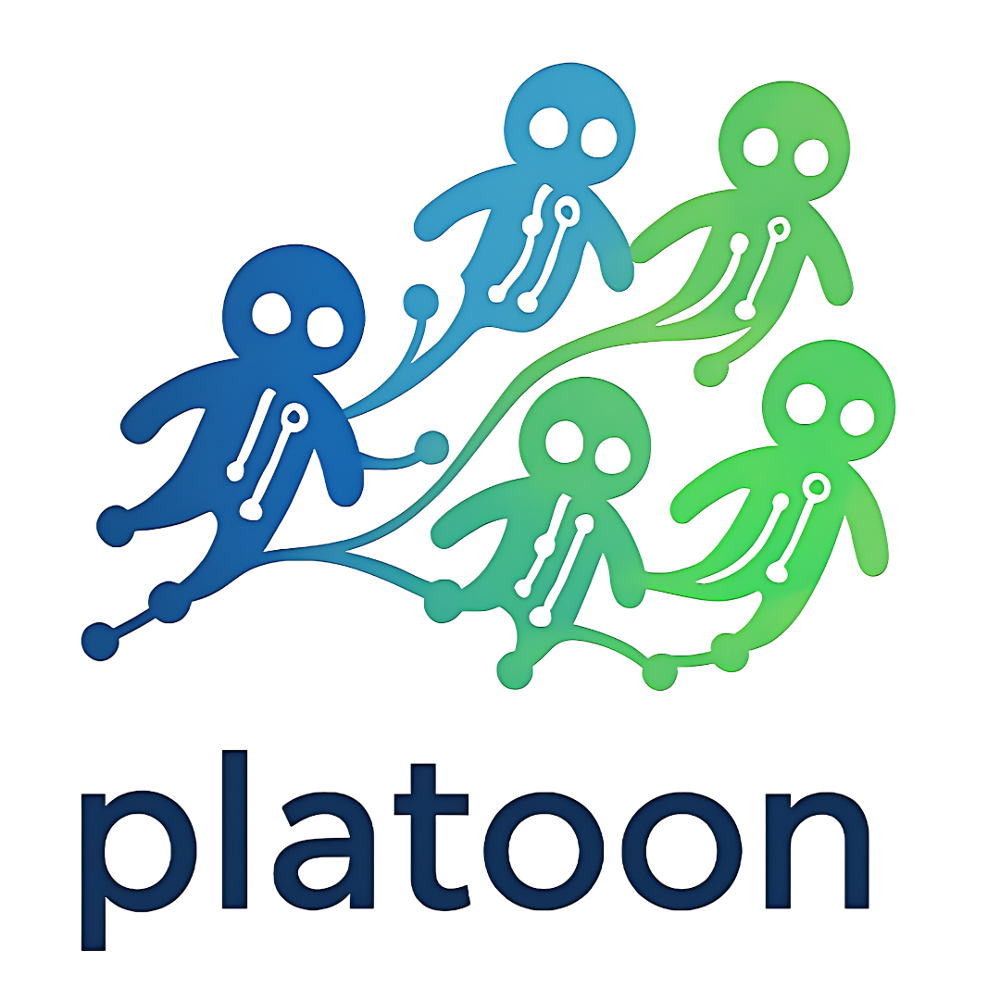

Build and train systems of agents.

Platoon trains LLM agents with reinforcement learning, supporting both single and multi-agent systems.
You bring an environment and any harness (the agent code); platoon runs
episodes, grades them, records the exact tokens of every model call, assigns credit across the agent tree and
trains the policy through a [Tinker](https://thinkingmachines.ai/tinker/)-compatible training service, either
hosted Tinker or a self-hosted server that implements the Tinker API, such as
[miles-tinker](https://github.com/neulab/miles-tinker).

What it gives you:

- **Any harness.** A harness is a Python function (`@pt.harness`) or a command-line agent described by a TOML
  spec (e.g., openhands, codex, pi, etc.). Harnesses with their own model client reach the policy over OpenAI-compatible HTTP;
  every call is recorded and trained on the tokens that were actually sampled.
- **Environments as services.** Any [OpenReward](https://openreward.ai) (ORS) `Environment` class, in process
  or on env servers, and [Harbor](https://github.com/harbor-framework/harbor) datasets, fetched by name from a registry
  (e.g., Hugging Face Hub) or read from a directory, each task graded by its own tests in a Docker, Singularity/Apptainer or
  enroot sandbox ([Train on a Harbor dataset](#train-on-a-harbor-dataset)).
- **Flexible training backend.** Supports both self-hosted (miles, skyRL, etc.) and hosted (tinker, fireworks, etc.) training services
  by targeting the tinker API, allowing you to either bring your own compute (BYOC) or use an API-based service to train.
- **Sandboxing.** Supports sandboxing via docker and rootless equivalents (e.g., singularity/apptainer, enroot). Extensible to other sandboxing
  backends.
- **Multi-agent support.** Natively supports algorithms for training multi-agent training, e.g., training for recursive sub-agent spawning,
  context-compaction, etc. Multi-policy training coming soon too!
- **Flexible credit assignment.** Mean or leave-one-out baselines per task group, depth weighting for recursive
  trees, and prefix merging that turns each trajectory into as few training datums as possible and customizable credit assignment.

## Concepts

| Term | Meaning |
|---|---|
| **environment** | Tasks, tools and a grader, served by an `EnvironmentService`; each rollout opens an `EnvSession`. |
| **harness** | Agent code: an `@pt.harness` function, or a command-line agent described by a TOML spec. |
| **agent** | One running harness in an episode, with its own model endpoint, tools, step budget and trajectory. |
| **subagent** | An agent another agent started with `ctx.agents.spawn`. |
| **episode** | One task's root agent plus its subagents: one rollout, which yields one trajectory per agent. |
| **program** | How an episode runs its agents (`@pt.program`); the default, `single`, runs the harness and grades. |

## Install

Platoon needs Python 3.12 or later. Install it with pip, or with [uv](https://docs.astral.sh/uv/):

```bash
pip install 'platoon[tinker,ors]'     # or uv pip install, or uv add in a uv project, with the same requirement
```

| Extra | Installs | Needed for |
|---|---|---|
| `tinker` | the Tinker SDK and tinker-cookbook | training and evaluation |
| `ors` | the `openreward` SDK | ORS environments, including the examples |
| `hpc` | `hpc-sandbox` | Singularity/Apptainer and enroot task sandboxes, for Harbor datasets on clusters |

The quickstart below, the tutorials and the example environments are in the repository. To run them, clone it
and install from its lock file with uv:

```bash
git clone https://github.com/ApGa/platoon.git
cd platoon
uv sync --extra tinker --extra ors
```

Below 1.0, a minor release may change the API, so pin one (`platoon[tinker,ors]>=0.4,<0.5`);
[CHANGELOG.md](CHANGELOG.md) has the release notes.

`platoon train`, `platoon eval` and `platoon rollout` need `TINKER_API_KEY` to sample the policy, and the Tinker
client takes only a key that starts with `tml-`. For a self-hosted server (for example
[miles-tinker](https://github.com/neulab/miles-tinker)), set `TINKER_BASE_URL` too; in a training config,
`tinker_base_url` takes its place for every Tinker client the config opens. W&B logging needs `WANDB_API_KEY`.

## Quickstart

A run needs three things: an environment, a harness that plays it, and a config that pairs them. The files
below are in [`examples/quickstart/`](examples/quickstart/README.md), which walks through them step by step.

**1. An environment.** Any ORS `Environment` class works. Its `@tool` methods are the agent's tools, and a
tool result that is `finished` with a `reward` ends and grades the episode:

```python
# examples/quickstart/guess.py (abridged)
class GuessTheNumber(Environment):
    @classmethod
    def list_splits(cls):
        return ["train", "test"]

    @classmethod
    def list_tasks(cls, split):
        return [{"id": f"{split}-{n}", "secret": n} for n in range(1, 101)]

    def get_prompt(self):
        return [TextBlock(text="Find the secret number from 1 to 100 with as few guesses as possible. ...")]

    @tool
    async def guess(self, args: Guess) -> ToolOutput:
        """Guess the number; the answer says whether the secret is higher or lower."""
        secret = self.task_spec["secret"]
        if args.number == secret:
            return ToolOutput(blocks=[TextBlock(text="Correct!")], reward=1.0, finished=True)
        return ToolOutput(blocks=[TextBlock(text="higher" if args.number < secret else "lower")])
```

**2. A harness.** Use a built-in one, or write a function. A function harness receives an `AgentContext`: the
instruction, the environment's tools, a step budget, and `chat`, which samples the policy and records the call
for training:

```python
# examples/quickstart/guesser.py
@pt.harness("example-guesser")
async def guesser(ctx: pt.AgentContext) -> pt.AgentResult:
    tools = [
        {"type": "function", "function": {"name": t.name, "description": t.description, "parameters": t.input_schema}}
        for t in await ctx.list_tools()
    ]
    messages: list[dict] = [{"role": "user", "content": ctx.instruction}]
    while ctx.budget.remaining() > 0:
        reply = await ctx.chat(messages, tools=tools)
        messages.append({key: value for key, value in reply.message.items() if value is not None})
        if not reply.tool_calls:
            return pt.AgentResult("completed", final_message=reply.text)
        for call in reply.tool_calls:
            arguments = json.loads(call["function"]["arguments"] or "{}")
            result = await ctx.call_tool(call["function"]["name"], arguments)
            messages.append({"role": "tool", "tool_call_id": call["id"], "content": result.as_text()})
            if result.finished:
                return pt.AgentResult("completed", final_message=result.as_text())
    return pt.AgentResult("limit")
```

**3. A config.** Each `environments` entry pairs a service with a harness:

```yaml
# examples/quickstart/train.yaml (abridged)
environments:
  - name: guess
    service: python://guess:GuessTheNumber
    harness: example-guesser         # or platoon-react, platoon-codeact, or {example-guesser: 1, platoon-react: 1}
    package: guesser                 # imported first, so @pt.harness("example-guesser") registers
train:
  model_name: Qwen/Qwen3-4B-Instruct-2507
  renderer_name: qwen3_instruct
  batch_size: 8
  workflow_config:
    group_size: 4
    rollout_config:
      max_steps: 10
```

**4. Run it.** Check one task, then train and evaluate:

```bash
cd examples/quickstart
PYTHONPATH=. uv run platoon rollout train.yaml --task train:41    # one task, printed as an agent tree
PYTHONPATH=. uv run platoon train train.yaml train.batch_size=16  # key=value overrides any config entry
PYTHONPATH=. uv run platoon eval eval.yaml                        # a JSON report on the test split
```

Every rollout opens an env session, runs the harness against platoon's model gateway, grades the session and
trains on the exact sampled tokens.

## Train on a Harbor dataset

A [Harbor](https://github.com/harbor-framework/harbor) dataset, a set of task directories that each hold an
instruction, a container image and the tests that grade the result, trains with configuration alone: a site profile
written once, one config and two commands. [`examples/harbor-dataset/`](examples/harbor-dataset/README.md) is the
project below, with a small dataset, ready to copy.

**1. Write the site profile, once per machine or cluster.** Where platoon keeps what it fetches and builds, where
runs write, and which container runtime starts the task sandboxes are facts of the site, not of a project. They go
in `~/.config/platoon/site.yaml` (or the file `$PLATOON_SITE` names), and configs leave them out:

```yaml
runs: ~/platoon-runs           # where a config that names no log_path writes its runs
# cache: ~/.cache/platoon      # what platoon prepare fetches and builds (the default)
# provider: docker             # the task sandboxes' runtime (the default); singularity or enroot on a cluster
```

On a cluster, point `cache` and `runs` at shared storage and name `singularity` or `enroot`, which need the `hpc`
extra ([Run on a cluster](docs/how-to/clusters.md#4-write-the-sites-profile-once)).

**2. Write one config.** It names the dataset, the agent that plays its tasks and the model to train:

```yaml
# examples/harbor-dataset/train.yaml
environments:
  - name: data-questions
    service: harbor
    service_kwargs:
      dataset: ./dataset                          # a directory of Harbor tasks; or hf://<org>/<name>@<commit>
      index: [{metadata: [topic]}]                # record each task.toml's [metadata] topic
      holdout: {fraction: 0.25, group_by: topic}  # whole topics held out: the eval split; train gets the rest
    harness: platoon-bash

train:
  model_name: Qwen/Qwen3-4B-Instruct-2507
  renderer_name: qwen3_instruct
  batch_size: 6                                   # tasks per step: all six training tasks
  max_training_steps: 10
  workflow_config:
    group_size: 4                                 # rollouts per task; rewards are centered within the group
    rollout_config:
      max_steps: 10                               # model calls per episode
      inference_params: {max_completion_tokens: 1024}

eval:
  every: 5                                        # the held-out tasks every 5 steps,
  at_start: true                                  # and at step 0, before the first update: the base model

stats:
  experiment_name: harbor-dataset                 # the run directory: <runs>/harbor-dataset/qwen3-4b
  trial_name: qwen3-4b
  wandb: {mode: disabled}                         # or mode online, to log to Weights & Biases (needs WANDB_API_KEY)
```

**3. Prepare it,** on a machine with network access, and again after any change to the environment entry. It
fetches the dataset into the cache and pins it with a lock, builds the images that its tasks build from Dockerfiles
and the toolchain that its harness runs from, loads the model's tokenizer, and prints which tasks are held out:

```bash
platoon prepare examples/harbor-dataset/train.yaml
```

**4. Train.** Each rollout runs the harness in a sandbox of its own task, and the task's tests grade what it left
there:

```bash
platoon train examples/harbor-dataset/train.yaml
```

Harbor and platoon name the same things differently:

| platoon | Harbor | What it is |
|---|---|---|
| environment | dataset | An `environments` entry with `service: harbor`: one dataset's tasks, their sandboxes and their grading. `dataset:` names it, as `hf://<org>/<name>@<commit>`, a Harbor Hub package (`harbor://<org>/<name>@<ref>`), a git directory (`git+<url>@<commit>#<path>`) or a directory |
| harness | agent | What plays each task, in the task's sandbox (`harness:`): `platoon-bash`, `mini-swe-agent@2.4.6`, `openhands@1.54.0.post1` or your own |
| provider | environment | The container runtime that starts each sandbox: `docker`, `singularity` or `enroot`, named by the site profile, or by `provider` in an entry's `service_kwargs` |
| task | task | One task directory: `task.toml`, `instruction.md`, `environment/`, `tests/` and `solution/` |
| verifier | verifier | The task's `tests/`, which write `reward.txt` or `reward.json` once the harness is done; `reward` in the entry's `service_kwargs` says which reported reward trains |
| rollout | trial | One attempt at a task; a training step runs `group_size` of them per task |

[Sandboxes and Harbor tasks](docs/how-to/sandboxes-and-harbor.md) covers every option: datasets on the Hugging Face
Hub, held-out splits, rewards, images, harnesses in task sandboxes and what platoon refuses to run.

## Built-in harnesses

| Harness | Kind | How the agent acts |
|---|---|---|
| `platoon-react` | function | calls the environment's tools as native tool calls |
| `platoon-codeact` | function | writes Python cells that call the tools as functions, and can launch subagents from code |
| `platoon-bash` | TOML spec | a small bash agent that needs only `python3`; it also offers the env's tools when they are served over MCP |
| `mini-swe-agent@2.4.6` | TOML spec | [mini-swe-agent](https://github.com/SWE-agent/mini-swe-agent), installed in the task sandbox |
| `openhands@1.54.0.post1` | TOML spec | an OpenHands SDK agent in the task sandbox, configured by options (reasoning replay, request timeout, retries, a condenser), from a toolchain that `platoon prepare` builds once per site |
| `platoon-oracle`, `platoon-noop` | function | no model calls: run the task's reference solution, or nothing, to check a dataset |

`uv run platoon harness list` lists every harness with the distribution that provides it, and `platoon harness
show NAME` shows one. Installed packages add harnesses, episode programs, named environments and reward processors
through entry points, which platoon imports only when a config names them
([RFC 0013](docs/rfcs/0013-extension-model.md)).

## Commands

| Command | Does |
|---|---|
| `platoon train CONFIG [k=v ...]` | trains with Tinker on the environments the config selects |
| `platoon eval CONFIG [k=v ...]` | evaluates a policy on an environment split and writes a report |
| `platoon rollout CONFIG --task ID` | runs one task and prints its agent tree, for debugging |
| `platoon prepare CONFIG [k=v ...]` | makes what a config's runs need, once per site: its datasets, images, toolchains and tokenizer |
| `platoon config show / validate` | prints the resolved config, or checks config files |
| `platoon harness list / show` | lists and inspects harnesses |
| `platoon harbor fetch / verify / images` | the steps of `platoon prepare` for Harbor datasets, one at a time, with the flags it does not take (`--shard`, `--push`, ...) |
| `platoon toolchain build SPEC ...` | builds the toolchains CLI harnesses run from inside task sandboxes |
| `platoon sandbox reap RUN_DIR` | stops the sandboxes a killed run left running |
| `platoon tasks show / export RUN_DIR` | a training run's per-task statistics: each task's groups, passes and expected pass@k |
| `platoon env list [CONFIG]` | lists environment service schemes, or a config's environments |
| `platoon viz ...` | the trajectory viewer: `tail`, `replay` and `show-dump` |

Configs are strict: an unknown key or a badly typed value fails before anything runs, with the dotted path of
the problem, and so does an option a harness does not take (`harness_options`, which a TOML spec declares in its
`[options]` table). A config can build on others with `extends:`, an override such as
`environments.0.harness_options.num_retries=5` sets an option on the command line, and `train`, `eval` and
`rollout` write the resolved config and a `lock.json` of versions and options into their run directory.

## Documentation

- [`docs/README.md`](docs/README.md): the table of contents of the documentation: getting started,
  tutorials, how-to guides, the command-line, config and Python API reference, the architecture, the RFCs and
  contributing.
- [`examples/quickstart/`](examples/quickstart/README.md): the tutorial above, step by step.
- [`examples/harbor-dataset/`](examples/harbor-dataset/README.md): a configuration-only project that trains on a
  Harbor dataset, the steps of [Train on a Harbor dataset](#train-on-a-harbor-dataset) with a small dataset.
- [`docs/architecture.md`](docs/architecture.md): how environments, harnesses, the model gateway, programs
  and the trainer fit together.
- [`docs/extending/`](docs/extending/index.md): your own harnesses, environments, programs, reward rules, judges,
  sandbox providers and renderers, and how to publish them as a package.
- [`docs/rfcs/`](docs/rfcs/README.md): design proposals for what comes next.
- [`examples/number-search/`](examples/number-search/README.md): the first run's configs, on number search, the
  example environment that ships with platoon (`env: platoon-number-search@1`).
- [`extensions/textcraft/`](extensions/textcraft/README.md): the TextCraft environments, a first-party extension
  (`platoon-textcraft`) with ready training and evaluation configs and a Harbor export of TextCraft-Synth.
- [`recipes/rao/`](recipes/rao/README.md): the RAO paper's TextCraft-Synth experiments, its single agent against its
  recursive agent and its ablation of the subagents' rewards, as configs that reproduce them.
- [`platoon/visualization/README.md`](platoon/visualization/README.md): the trajectory viewer.

## Repository layout

| Path | Contents |
|---|---|
| `platoon/envs/` | the environment-service contract, ORS environments, task tables, the Harbor backend and number search |
| `platoon/harness/` | the agent contract, function harnesses, TOML specs and their runner, subagents, budgets, verifiers and the built-in harnesses |
| `platoon/gateway/` | the model gateway: rendering, sampling, parsing and recording every model call, and the MCP tool plane |
| `platoon/programs.py`, `platoon/gym.py` | episode programs, and adapters from step environments |
| `platoon/train/` | training: the trainers and their lifecycle (`trainer/`), the policies (`policy/`) and what they train under (`objectives/`), a training step (`step/`), the run's draws and what starts the training groups (`dispatch/`), the rollout workflow (`workflow/`), credit assignment (`credit/`), the rollout workers (`workers/`), checkpoints (`checkpoints/`), evaluation during training (`evaluation/`), the config and task selection; the policy client and its renderers (`tinker/`). [The training code](docs/training-code.md) maps it |
| `platoon/eval/` | `platoon eval` |
| `platoon/sandbox/` | task sandboxes: `process`, `docker`, `singularity` and `enroot` |
| `platoon/hooks.py` | named hooks through which extensions plug into core |
| `extensions/` | first-party extensions, each a distribution of its own in the uv workspace: `extensions/textcraft` (`platoon-textcraft`) |
| `recipes/` | configs that reproduce published experiments, checked on CPU: `recipes/rao` |
| `examples/` | runnable examples, each tested in `tests/examples/` |

## Contributing and development

[CONTRIBUTING.md](CONTRIBUTING.md) is the full guide: the development setup, the tests (and the few that skip
without local files), the commit and pull request conventions, and how to add an environment, a harness, a
renderer or an example. In short, set up a development environment and run the checks that CI runs:

```bash
uv sync --dev --extra tinker --extra ors
uv run pre-commit install         # lint each commit and check its message
uv run pytest tests
uvx pre-commit run --all-files    # ruff and ruff format, as CI runs them
```

The test suite runs on CPU with scripted policies in place of a training service, and with `platoon.testing`'s toy
tokenizer, which renders the Qwen3 chat format, so it needs no model download. Only the tests of real models' chat
templates need local tokenizer files, and skip without them; see
[CONTRIBUTING.md](CONTRIBUTING.md#tests-that-skip-without-local-files). To test your own environment, harness or
program the same way, see [Test an environment, a harness or a program on CPU](docs/how-to/test-extensions.md).

How to propose a change:

- **Bug fixes and small features** (such as a new option on an existing harness or environment) go straight to
  a pull request with tests. New examples go under `examples/<name>/` with a CPU test under `tests/examples/`, so
  they keep working.
- **Changes to a public contract or to what trains, new subsystems, backends or required dependencies, renames
  or removals of public names, and work that needs several pull requests or spans repositories** start as an
  RFC: a design proposal in [`docs/rfcs/`](docs/rfcs/README.md) with a summary, motivation, proposal,
  alternatives, a rollout plan with milestones and open questions, discussed in a pull request of its own before
  the implementation. [When a change needs an RFC](CONTRIBUTING.md#when-a-change-needs-an-rfc) has the full
  list, and the [RFC process](docs/rfcs/README.md#how-to-propose-a-change) covers numbering, review, the
  lifecycle and how an RFC links the pull requests that implement it. Start from
  [the template](docs/rfcs/0000-template.md).
- **Commit messages and pull request titles** follow Conventional Commits, such as
  `fix: Close ORS sessions when a rollout is cancelled`; see
  [Commits and pull requests](CONTRIBUTING.md#commits-and-pull-requests).

Core never imports an extension. Extensions register functions into named hooks (`platoon/hooks.py`) when
their modules are imported, and harnesses, programs and environment services are referenced by name or
`module:attr` from configs. [Extending platoon](docs/extending/index.md) lists every extension point.

## License

Platoon is released under the MIT License; see [`LICENSE`](LICENSE). Its tool-call parsers follow SGLang's, which
are licensed under the Apache License 2.0; see their
[`NOTICE`](platoon/train/tinker/renderers/tool_parsers/NOTICE). Some test fixtures are copies of Harbor's files,
which are licensed under the Apache License 2.0 too; see their [`NOTICE`](tests/envs/fixtures/harbor-compose/NOTICE).

## Citation

Platoon was originally designed for the paper
[Recursive Agent Optimization (RAO)](https://arxiv.org/abs/2605.06639).
The codebase has since evolved greatly. To reproduce those results 
use the [`apga/rao-snapshot`](https://github.com/ApGa/platoon/tree/apga/rao-snapshot) branch of
[ApGa/platoon](https://github.com/ApGa/platoon), a snapshot of the code the paper used.

Please cite the following if you found platoon to be useful in your work:

```bibtex
@article{gandhi2026rao,
  title   = {Recursive Agent Optimization},
  author  = {Gandhi, Apurva and Chakraborty, Satyaki and Wang, Xiangjun
             and Kumar, Aviral and Neubig, Graham},
  journal = {arXiv preprint arXiv:2605.06639},
  year    = {2026}
}
```

```bibtex
@misc{gandhi2025platoon,
  author       = {Gandhi, Apurva},
  title        = {{Platoon}: Build and Train Systems of Agents},
  howpublished = {\url{https://github.com/ApGa/platoon}},
  year         = {2025}
}
```
