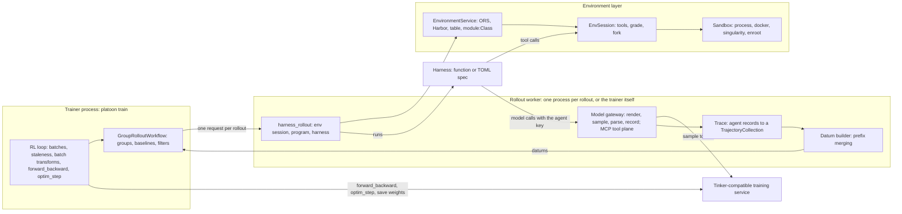

# Platoon architecture

This document explains how platoon is built: the layers a rollout passes through, the contracts between them,
and the rules that keep training data honest. It is for readers who want to extend platoon (a new environment
service, harness, episode program or credit rule) or understand what a config setting does. For a hands-on
start, see the [quickstart](../examples/quickstart/README.md).

## Overview

Platoon trains LLM agents with reinforcement learning through a Tinker-compatible training service: hosted
Tinker, or a self-hosted server such as [miles-tinker](https://github.com/neulab/miles-tinker). A run has four
layers:

- **Environments** serve tasks, tools and grades behind one contract (`EnvironmentService`, `EnvSession`).
  Any OpenReward (ORS) `Environment` class is an environment, in process or on env servers, and so is a
  directory of Harbor tasks, each run in its own sandbox and graded by its own tests.
- **Harnesses** are agent code: a Python function registered with `@pt.harness`, run inline in the rollout
  process, or a command-line agent described by a TOML spec and run as a subprocess or inside the task's
  sandbox.
- **The model gateway** is the only way a harness reaches the policy. It renders each request to tokens,
  samples through the training service, parses the reply and records the exact prompt and sampled tokens. It
  also serves each agent's environment tools over MCP.
- **The trainer** groups rollouts by task, assigns group-relative credit to every agent in each rollout, turns
  the recorded calls into training datums and trains the policy.

**Episode programs** sit between the harness and the environment: a program decides how one task's rollout
runs its agents, grades them and post-processes the result.

Every model call goes through the gateway and is recorded there, so the trainer never depends on how a harness
works inside: a Python loop, a CLI agent in a container, or a tree of recursive subagents all produce the same
records.

### Glossary

| Term | Meaning |
|---|---|
| **environment** | A source of tasks with tools and a grader, served by an `EnvironmentService`; a rollout opens an `EnvSession` for its task. |
| **harness** | Agent code: a Python function (`@pt.harness`, run inline) or a command-line program described by a TOML spec (`HarnessSpec`, run by `HarnessRunner`). |
| **agent** | One running harness in an episode, with its own model endpoint, tools, step budget and trajectory. The gateway records it as an `AgentSession`; a function harness sees it as an `AgentContext`. |
| **subagent** | An agent another agent started, with `ctx.agents.spawn`. The root agent and its subagents form the episode's *agent tree*. |
| **agent key** | The 256-bit secret that identifies an agent at the gateway, for model calls and MCP tool calls alike. |
| **episode** | One task's root agent plus its subagents: one rollout, which yields one `TrajectoryCollection` with a trajectory per agent. |
| **program** | How an episode runs its agents (`@pt.program`). The built-in `single` runs the environment's harness on the root agent and grades the session. |
| **outcome** | The grade of an episode or agent: `scored` with a reward, or an untrainable `invalid`, `error`, `timeout` or `cancelled`. |

### The picture



### One training step

1. The trainer's dispatcher draws the next task of the order and starts its group when the group can start: within
   the horizon of `train.max_staleness` (at most `max_staleness + 1` batches of groups started and not yet trained),
   with rollout permits (`train.max_concurrent_rollouts`), and with room in its label's
   `train.rollout_group_limits`; a draw whose label is at its limit waits in the label's backlog, outside the horizon,
   for the slot the label's running groups hold for it. Each rollout returns its permit as it ends
   (`train.permit_release: rollout`, the default), and a group whose workflow runs its rollouts on the lease starts on
   its first permit, its rollouts starting as the rest free; any other group starts on its whole size of permits, as
   every group does under `train.permit_release: group`, which returns them when the group ends.
2. For each task, `GroupRolloutWorkflow` runs `group_size` rollouts, with the settings of the task's environment
   entry (its own `workflow_config` laid over `train.workflow_config`). With
   `train.workflow_config.rollout_isolation: process`, each rollout runs in its own worker process, which
   follows the trainer's latest sampling weights.
3. In the worker, `harness_rollout` opens an env session for the task, starts the gateway, runs the
   environment's episode program (which runs the harness), grades the session and builds a
   `TrajectoryCollection` from the gateway's records.
4. Still in the worker, the datum builder turns each trajectory's model calls into Tinker datums by prefix
   merging, with the trajectory's reward as its provisional advantage.
5. Back in the workflow, the group's completed roots set the baseline (the group mean, or leave-one-out),
   every datum is centered, and the group's datums are queued, with its verdict and what each rollout returned,
   which the trainer records in the run's per-task statistics.
6. The trainer drops rollouts older than their entry's staleness bound (its `max_staleness`, else
   `train.max_staleness`), applies batch transforms per microbatch (such as
   depth weighting), skips datums with zero advantage while keeping their share of the loss normalization,
   runs `forward_backward` and `optim_step`, saves weights and publishes the new sampler to the workers. A full
   checkpoint also saves the per-task statistics, and, in a file of the dispatcher's own, where the draws stand, with
   the groups that settled and that no step has trained yet, which a resume trains as they are.

Rollouts whose outcome is not `scored` never train as reward 0: the workflow keeps them out of baselines and
out of the batch.

### Rollout workers

With `rollout_isolation: process`, each rollout runs in a worker process that leads a session of its own, so the
trainer's supervisor can kill it as a group. A worker stops on SIGTERM (the supervisor's straggler kill) and when
its trainer dies (PDEATHSIG, and a check of its parent in case that signal was lost). It is gone within 8 seconds,
whatever its rollout does:

1. It shuts its model gateway down and refuses remote env calls, so no model call, tool call, subagent or env
   session starts again, even from a harness that ignores cancellation or calls from threads of its own.
2. It deletes its remote env sessions.
3. It cancels every task of the rollout, again and again for tasks that swallow the cancellation, but lets the
   rollout's cleanups finish: env teardowns, and the SIGTERM, grace and SIGKILL of a command the rollout ran.
4. It sends SIGTERM, and SIGKILL half a second later, to the process groups the rollout started in sessions of
   their own (a harness CLI on the rollout host, sandbox commands, and the sessions their descendants started),
   then SIGKILLs its own process group.

A worker only reaches the processes it can find in its own process tree. A daemon whose parent had exited before
the worker began stopping is not reached, nor a command that a stopping harness starts in a session of its own and
whose parent is killed before the worker looks again; a worker killed with SIGKILL from outside ends nothing.
Supervisors record their live workers on disk, so the restart wrapper and the next trainer's supervisor kill the
workers a dead trainer left running before new ones start.

A worker is forked from a fork server (`worker_start_method: forkserver`, the default; `platoon.utils.forkserver`):
one process per supervisor that imports the worker's stack once (tinker, torch, transformers and the environments'
packages), which an exec'd worker would spend 17-24 s on, and about a minute when 64 start at once on one node, and
builds the run's tokenizer and renderer once, of which each worker it forks takes its own copy. It also imports what
the run's environments and harnesses import when a rollout opens them, and builds what each rollout would build again
(`platoon.train.startup`, from the config: an ORS environment's module and SDK, each function harness's module, the
programs, the registry lookups, an in-process environment's task lists, and `workflow_config.worker_preload`), each
module and build only when it leaves the server as safe to fork as it was: no thread started, no file, socket or event
loop left open, no process started and no numpy generator seeded from the OS (an environment variable one sets is set
in each worker too). One that is not is left out and logged, and once it has tried them all the server executes itself
again without them, since an import cannot be undone; the processes they started are ended and none of their
descriptors passes on. A
value an import makes once per process (an id, a temporary directory) is shared by the workers, which is why only
modules that keep none belong in the preload, and why nothing is derived under `worker_python_env_isolation`, whose
rollouts import their environments inside a Python overlay of their own. `platoon train` starts the server as soon as
its training client is open, so that it imports while the trainer saves at launch, and stages the harness toolchains
on the node meanwhile.
Right after the fork, the child becomes the process `python -m platoon.train.tinker.workers.entrypoint` would be: a
session of its own, `/dev/null` as stdin, its log file, the trainer's working directory and exactly the environment
an exec'd worker gets, new seeds for numpy's and torch's generators and for every `random.Random` the server's
imports seeded from the OS (sympy's, datasets' fingerprint generator), the worker invariants and the startup alarm;
it then runs the entrypoint as `__main__`. It keeps the server's string hash seed. The fork server runs no thread of
its own and forks nothing while another runs (jemalloc's background thread aside), dies with the trainer, and stops
the workers it forked if it dies itself; the supervisor then starts another, unless it said it cannot serve, and does
when the trainer's environment or working directory changed since the server started, which its imports may have
read. A worker no fork server can fork (one failed to import, a thread runs in it, a fork failed) starts by exec, as
every worker does with `worker_start_method: exec`; the trainer logs why, naming each thread and what it is. So does a
worker asked for while the server is still importing after the worker's startup budget; the server is not killed for
it, and forks the workers asked for after it has imported the stack (a server that then finds it cannot serve turns
forking off, as one that says so in time does). The trainer gives up on a fork only once the server has answered no
request for a minute, and reads what the server sent before it judges: on a node whose CPUs are all busy, the
trainer's event loop can be held up for minutes, and a worker forked meanwhile is still the trainer's.

Neither the fork server nor a worker sees a GPU or starts the CUDA driver: their environment hides the GPUs and has
torch ask NVML (`CUDA_VISIBLE_DEVICES=` and `PYTORCH_NVML_BASED_CUDA_CHECK=1`), so the `torch.cuda.is_available()`
that transformers calls at import answers from the environment alone. On a node with an NVIDIA driver it would
otherwise start the driver, GPU visible or not (with either variable alone too), and the driver's thread would keep
the fork server from forking: every worker would start by exec, and pay for the driver. A worker needs no GPU of its
own: it samples through the training service, and the sandboxes it starts get their GPUs from their provider (the
singularity provider's `gpu: nv`), not from its environment.

### Where the code is

| Path | Contents |
|---|---|
| `platoon/envs/` | the service contract (`service.py`), ORS services (`ors/`), task tables (`table.py`), Harbor (`harbor/`), the per-env call gate (`gate.py`), named environments (`named.py`) and number search (`number_search/`) |
| `platoon/sandbox/` | the sandbox interface (`base.py`) and the `process`, `docker`, `singularity` and `enroot` providers |
| `platoon/gateway/` | `ModelGateway` and `AgentSession` (`core.py`), the HTTP server (`server.py`), the MCP tool plane (`mcp.py`), trajectories from agent records (`trace.py`), wire dialects (`dialects/`) |
| `platoon/harness/` | the agent contract (`agent.py`), `@harness` (`function.py`), the inline runtime (`inline.py`), subagents (`agents.py`), budgets (`budget.py`), verifiers (`verify.py`), `harness_rollout` (`rollout.py`), TOML specs (`spec.py`, `runner.py`), the registry (`registry/`) and the built-in harnesses (`builtin/`) |
| `platoon/programs.py`, `platoon/rewards.py`, `platoon/gym.py` | episode programs, the reward processor and finalizer for recursive agents, and gym adapters |
| `platoon/train/tinker/` | the trainer, its config, the rollout workflows, the rollout workers and the renderers |
| `platoon/eval/` | `platoon eval` |
| `platoon/cli.py`, `platoon/utils/config.py` | the CLI and the config loader |
| `platoon/hooks.py` | named hooks for extensions |
| `extensions/`, `recipes/` | first-party extensions (`extensions/textcraft`, the distribution `platoon-textcraft`), and configs that reproduce published experiments (`recipes/rao`); neither is in platoon's wheel |

The public API is re-exported from `platoon` (`import platoon as pt`): `pt.harness`, `pt.program`,
`pt.AgentContext`, `pt.AgentResult`, `pt.SubagentResult`, `pt.EpisodeContext`, `pt.Outcome`, `pt.Task`,
`pt.gym` and the rest of `platoon.__all__`.

## Environments

### The contract

`platoon/envs/service.py` defines what every environment provides:

```python
class EnvSession(Protocol):
    task: Task
    instruction: str
    sandbox: Sandbox | None  # a task sandbox a harness can run in, or None

    async def tools(self) -> list[ToolSpec]: ...
    async def call_tool(self, name: str, arguments: dict[str, Any]) -> ToolResult: ...
    async def grade(self) -> Outcome: ...  # never raises for infrastructure failures
    async def fork(self, mode: ForkMode = "shared", *, task: Task | None = None) -> "EnvSession": ...
    async def close(self) -> None: ...


class EnvironmentService(Protocol):
    name: str

    async def list_tasks(self, split: str) -> list[str]: ...
    async def get_task(self, task_id: str) -> Task: ...
    async def open(self, task: Task, *, rollout_id: str) -> EnvSession: ...
```

A `ToolSpec` is a tool's name, description and JSON schema, plus two hints: `terminal` (the tool ends the
episode, like a submit tool) and `read_only` (it never changes env state). A `ToolResult` carries MCP-style
content blocks, `is_error`, and the episode signals `finished` and `reward`.

### Outcomes

```python
OutcomeStatus = Literal["scored", "invalid", "error", "timeout", "cancelled"]


@dataclass
class Outcome:
    status: OutcomeStatus
    rewards: dict[str, float] = field(default_factory=dict)  # named components
    primary: str = "reward"
    reason: str | None = None  # "no_submit", "context_overflow", ...
    failure_kind: str | None = None  # infrastructure taxonomy for error and invalid
    metadata: dict[str, Any] = field(default_factory=dict)
```

The rule: **infrastructure failures never become reward 0.** A grader that crashes, a sandbox that dies or a
verifier that cannot run gives `error`; an environment that declares its grade unusable gives `invalid`. A
policy failure, such as never submitting, is `scored` with reward 0 and a `reason`. Only `scored` outcomes
train.

### Services

An `environments` entry names its service with a string:

| Service | Backend |
|---|---|
| `python://pkg.mod:EnvClass` | an ORS `Environment` class, run in the rollout worker, one instance per session |
| `ors+http://<host:port>[,<host:port>...]/<EnvName>` | sessions on ORS env servers through the `openreward` client; a pool of servers is sharded by rollout id. `<EnvName>` names the deployment: a server answers requests without a variant with its default (first) environment, so `?variant=<Env>` selects another, and an env name that is one of the server's other environments is refused |
| `ors+http:///<EnvName>` | the same, with the server pool from `OPENREWARD_SESSION_URLS_<LABEL>`. `platoon train`, `eval` and `rollout` refuse a mixture whose entries without a variant would reach one server under different env names, as an entry whose variable is unset does when it falls back to a process-wide pool |
| `harbor` | Harbor task directories (`service_kwargs: {dataset_dir, provider}`), one sandbox per session |
| `table` | rows of a task table (`service_kwargs: {path: tasks.jsonl}`): tasks with no tools and no grader, for harnesses that grade themselves |
| `pkg.module:Class` | any `EnvironmentService` factory, called with `service_kwargs` |

`platoon env list` prints these schemes. ORS task ids are `<split>:<index>`; a worker resolves its task without
listing the whole catalog. `dataset_kwargs` and `eval_dataset_kwargs` choose tasks with `split_name` (one split
or a list), `shuffle_seed` and `limit`, for any service. An entry's `exclude_tasks` leaves tasks out of both lists
by id or by name (through the optional `list_task_names` of a service whose task names are not its ids) before
`limit` takes its share; an item that names no task of the environment, in any of its splits (`list_splits`), is a
configuration error.

### ORS environments

An ORS environment is an ordinary `openreward.environments.Environment` class: `@tool` methods with one
pydantic parameter model, and a terminal call that returns `ToolOutput(finished=True, reward=...)`. The class
never imports platoon. Platoon reads optional hints and hooks from it when it runs in process, and the hints (not
the hooks) also when a remote service names the class its env servers serve (`env_class`):

| Attribute | Effect |
|---|---|
| `platoon_terminal_tools`, `platoon_read_only_tools` | tool names with the `terminal` and `read_only` hints (remote envs: the `terminal_tools` and `read_only_tools` service options) |
| `platoon_concurrent_tools` | tools that may overlap other calls on the same env (see [Concurrency](#concurrency-on-a-live-env)) |
| `platoon_tool_meta` | MCP `_meta` per tool (remote envs: the `tool_meta` option, since an env server sends no meta) |
| `platoon_fork(self, task_spec)` | a child with its own goal on shared state (a `shared` fork) |
| `platoon_copy(self)` | the env a `copy` fork gets |
| `platoon_grade(self)` | a grade from state when the policy never called a terminal tool |

Grading fails closed:

| Situation | Outcome |
|---|---|
| the first `finished` result has a numeric reward | `scored` with that reward |
| ... its metadata has `{"invalid": true}`, or it has no reward | `invalid` |
| no terminal call, `max_tool_calls` reached | `scored` with the last reward or 0, `reason="max_tool_calls"` |
| no terminal call, and the env defines `platoon_grade()` | its grade |
| no terminal call, and an infrastructure failure: the session died for one, a call failed in transport, a terminal tool raised, or a tool raised one of the openreward SDK's session or transport errors | `error` (`env_error`) |
| no terminal call otherwise | `scored` 0, `reason="no_submit"` |

Any other tool that raises is the policy's call gone wrong, in process and on an env server alike: the model sees
the error as an `is_error` result. An openreward client from 0.1.163 on ends a remote session whose tool raised, so
later calls are refused and the episode is graded as it stands.

### Forks

Multi-agent systems differ in what a child sees, so `EnvSession.fork` makes it explicit:

| Mode | The child gets | Use |
|---|---|---|
| `shared` (default) | a new session handle on the same live state; with `platoon_fork`, its own goal and terminal result on that state | recursion: children work in the parent's workspace |
| `copy` | an independent copy of the state | verifying a child on its exit state, isolated child workspaces, tree search |
| `fresh` | a new session of the same task in its initial state | independent peers, retries, best-of-n |

`task=` sets the child's task (its goal and budget) in every mode. A mode the environment cannot provide fails
loudly; it never degrades from `copy` to `shared`. An in-process env class with a `teardown` but no
`platoon_copy` refuses `copy`, because a deep copy would share its external resources.

### Concurrency on a live env

A *live env* is the state that forks share. Every agent on a live env (the root, its subagents, verifiers)
reaches it through one gate (`platoon/envs/gate.py`), which gives each operation one of three classes:

| Class | Operations | Runs |
|---|---|---|
| serial | every tool by default, read-only tools included | one at a time |
| concurrent | tools declared safe to overlap (`@tool(concurrent=True)`, `platoon_concurrent_tools`, the `concurrent_tools` option) | beside serial and other concurrent calls |
| exclusive | terminal tools, grading that reads env state, copy snapshots, `platoon_fork` hooks, the first tool listing | alone, once everything in flight has ended |

Calls are first in, first out within an agent and take turns across agents. An exclusive operation is a
barrier in arrival order: a call sent before a submit runs before it, and a call sent after it finds the
episode finished. A call that waits longer than `queue_timeout_s` (default 240 s) is refused with
`Not run: env busy` and never reaches the env.

### Lifecycle

In process, an ORS environment runs as the SDK's own server runs it: constructor, `setup`, `get_prompt`, tool
calls, `teardown`. Synchronous methods run on threads of their own, so a hung call cannot block the event loop.
Teardown runs on every path, including failed setup and cancellation, and waits for calls still in flight.

### Harbor tasks

The `harbor` service serves [Harbor](https://github.com/laude-institute/harbor) task directories:

| Harbor artifact | Platoon's use |
|---|---|
| `instruction.md` | the session's instruction |
| `task.toml` | timeouts, resources and metadata |
| `environment/` | the sandbox image |
| `tests/` | uploaded after the agent finishes; `tests/test.sh` writes `reward.txt` (one number) or `reward.json` (named components) |
| `solution/` | the oracle solution |

A task's id is its name in the dataset's `registry.json`, else its directory's name, or its relative path when it
sits deeper; a fetched dataset's ids come from its lock (`platoon harbor fetch`). Two tasks with the same id are an
error, even when one of them is refused. Each session gets its own sandbox. A missing or malformed reward file
is an `error`, a verifier timeout is `invalid`, and a `reward.json` may declare itself `invalid`. A Harbor session
also offers generic `bash`, `view`, `write` and `edit` tools on its sandbox, for harnesses that do not act
natively. Tasks that need several containers (`environment/docker-compose.yaml` with sidecar services) are refused
rather than run without their services; [RFC 0010](rfcs/0010-harbor-registry-and-multi-container-tasks.md) proposes
support for them.

**Grading** (`HarborSession.grade`, `platoon/envs/harbor/session.py`) takes the sandbox the tests run in away from
the agents. It runs alone on the session's gate, after the calls in flight, and kills every process the agents left
running (`Sandbox.kill_processes`); checks the workdir, and scores the attempt 0 without its tests
(`workdir_missing`) if the agents removed or moved it, left something else in its place or locked it, since no
command starts there then. A task graded in the agents' own sandbox (Harbor's `shared` verifier mode) then gets
`/tests` and `/logs/verifier` made afresh, its tests uploaded and `tests/test.sh` run there. A task with a separate
verifier gets its artifacts copied out as directories and regular files only (`platoon/envs/harbor/artifacts.py`:
packed with `tar` in the sandbox, unpacked on the host without symlinks or special files) and graded in a sandbox
of its own. In either sandbox grading kills whatever the tests left running, since they may have run the agent's
code, and only then reads the reward files and the end of the verifier's logs, in the sandbox with its own shell
(`platoon/envs/harbor/verifier.py`), each only if it is a regular file reached through no symlink, with nothing
mounted over it, a reward file only up to 1 MiB. A reward file of any other kind can only come from code the tests
ran, the agent's, so it scores 0 as a trainable failure (`reward_file_not_regular`, `reward_file_too_large`),
whatever a symlink points to. A grade whose processes cannot all be killed is an `error` (`verifier_isolation`),
never a guess.

### Sandboxes

`platoon/sandbox/base.py` defines `SandboxSpec` (image, workdir, env, mounts, network, CPUs, memory, labels,
upstreams), `Sandbox` (`exec`, `upload`, `download`, `snapshot`, `kill_processes`, `stop`, and `routes`) and
`SandboxProvider`. `kill_processes` kills what commands left running and keeps the sandbox: the `process` provider
kills each command's process group and every process that carries the sandbox's `PLATOON_SANDBOX_ROOT`; the
container providers list the processes that keep the container alive when it starts, then kill every other process
in its PID namespace from inside it, after freezing them all at once (`platoon/sandbox/_processes.py`). They refuse
a sandbox that shares platoon's PID namespace, where the kill would reach processes outside it.

| Provider | Isolation | Use |
|---|---|---|
| `process` | none: a host directory stands in for the sandbox, and commands run as host processes | tests and laptops |
| `docker` | a container | machines with Docker |
| `singularity` | a SingularityCE or Apptainer instance, through `hpc-sandbox` (the `hpc` extra) | HPC clusters without Docker |
| `enroot` | an enroot container, through `hpc-sandbox` | HPC clusters with enroot, typically under Slurm |

Providers declare capabilities (`snapshot`, `network_none`, `gpu`, `isolation`, `routes`, `host_loopback`), and
callers check capabilities rather than provider names. `host_loopback` says that a sandbox on the host network shares
this host's network namespace, as every built-in provider's does, so a harness in it reaches the gateway on loopback;
without it, or a route, platoon does not place a harness in the sandbox. A spec's `upstreams` name host services that
the sandbox's processes must reach, such as the gateway's Unix socket, and the sandbox's `routes` say how: in a sandbox
without a network, the socket's directory is bound into it and a forwarder relays a loopback port to the socket
(`platoon/sandbox/routes.py`). Every built-in provider labels its sandboxes with the rollout worker that started
them and can `reap` sandboxes by label, so a training worker's supervisor removes what a killed worker left, and
`platoon eval` removes what its killed or hung worker processes left (`platoon/sandbox/cleanup.py`). The
`singularity` and `enroot` providers pass their `provider_options` to `hpc-sandbox`. The enroot provider also
accepts the singularity provider's option names, so a block written for a Singularity site serves an enroot site,
except `binary` and `extra_start_args`, which each runtime reads as its own executable and start flags. `root` is an
enroot-only alias for `remap_root`.

## The model gateway

`platoon/gateway` gives every harness a model endpoint whose every call is recorded with its exact tokens.

**Core.** `ModelGateway` holds the sampler (a Tinker `SamplingClient`, or any object with `sample_async`), the
renderer and the tokenizer. `open_agent` mints an agent with a 256-bit key. `chat(agent, request)` renders the
messages and tools to tokens, samples, parses the content, reasoning and tool calls, and records the call, its
prompt tokens, sampled tokens and logprobs, under a fresh call id on the agent.

**Tools.** Whatever the dialect, every renderer is handed each tool as a plain function of the name, description
and parameter schema the request gave (`platoon/gateway/core.py`, `chat_tools`), so nothing a provider would run,
constrain or defer reaches the policy. A provider's built-in or server tool becomes a function of its name, fields
such as `strict` and `defer_loading` go, and a tool without a schema gets the empty-object one. A Chat Completions
tool without a name is refused with a 400, while a Messages MCP toolset and the Responses tools other than named
functions are left out. A hosted model gets the same tools (below).

**Server.** Each rollout starts an aiohttp server for harnesses with their own client:

| Route | Purpose |
|---|---|
| `POST /v1/chat/completions` | OpenAI Chat Completions, including `stream: true` with keepalives |
| `POST /v1/responses`, `POST /v1/messages`, `/v1/messages/count_tokens` | OpenAI Responses and Anthropic Messages (experimental) |
| `GET /v1/models`, `GET /healthz` | discovery and health |
| `POST /v1/platoon/agents` | mints a subagent (`{role, goal?}` to `{agent_id, api_key, base_url}`) for exact per-agent attribution |
| `/mcp` | the MCP tool plane (below) |

An agent authenticates with its key as `Authorization: Bearer`, as `x-api-key`, or in the path
(`/s/<agent key>/v1/...`) for clients that cannot set headers. The server listens on the rollout host and
advertises a loopback URL, where the agent key is its only access control, and it takes only its own rollout's
keys. For task sandboxes without a network it also listens on a Unix socket in a private directory, which the
sandbox reaches through its route.

**Call kinds.** Every call carries a kind (`ctx.chat(kind=...)`, or the `X-Platoon-Call-Kind` header):

| Kind | Counts as a budget step | Trains |
|---|---|---|
| `policy` (default) | yes | yes |
| `aux` | no | yes: calls a harness makes for itself, such as summarizing its context |
| `judge` | no | no; kept for audit under the trajectory's `judge_calls` |

A gateway step budget (`AgentSession.call_cap`) counts the policy calls of the capped agent and of every agent
minted under it over HTTP together. A harness in a task sandbox, where code the policy runs can read its key
(`AgentSession.policy_only`), makes no `judge` calls, and no `aux` calls under a gateway step budget, which would
not count them: the server answers those with a permission error (403). Without a gateway step budget its `aux`
calls are sampled, recorded and trained as its policy calls are (`AgentSession.sampling_kind`), and the gateway
counts neither.

**Sampling.** A rollout's `inference_params` (`temperature`, `top_p`, `top_k`, `max_completion_tokens`) are the
default sampling of every agent in its tree. A parameter the call sets wins, then the rollout's default, then the
gateway's own (temperature 1, top_p 1, no top-k cutoff, 4096 completion tokens). With the rollout's
`sampling_precedence: config`, a policy call samples with the rollout's temperature, top_p and top_k (or the
gateway's), never its own, and so does an `aux` call of a harness in a task sandbox. The completion budget is
clamped to the context the prompt leaves, and a prompt that overflows the context window gets the dialect's native
context-length error, so a harness can condense its context instead of retrying.

**Hosted models.** For evaluation, a `HostedGateway` (`platoon/gateway/hosted.py`) puts a hosted model behind
the same agents, call kinds, budgets and records (`inference.hosted`). Each call goes to one base URL in the
harness's own dialect, with the tools normalized as the training dialects normalize them (each dialect module's
`hosted_body`), and the reply goes back as the server sent it; nothing is translated between dialects. Its calls
record the provider's usage and ids instead of token ids, so they never train
([Evaluate a hosted model](how-to/evaluate-hosted-models.md)).

### The MCP tool plane

The gateway also serves each agent's environment tools over MCP, so any MCP-capable harness can act through an
environment without a sandbox. The endpoint is `<gateway>/s/<agent key>/mcp`, or `<gateway>/mcp` with
`Authorization: Bearer <agent key>`, over MCP streamable HTTP (`initialize`, `tools/list`, `tools/call`,
`notifications/cancelled`, `ping`). Long tool calls answer with SSE and send keepalives while the tool runs.

Each agent sees the tools its access level allows:

| Access | Lists |
|---|---|
| `full` | every tool (root agents) |
| `no_terminal` | every tool except terminal ones such as submit |
| `read_only` | only tools marked read-only (verifiers by default) |

A tool the agent does not see cannot be called. `finished`, `reward` and `metadata` travel in
`_meta["platoon"]`, which MCP clients do not show the model, so rewards stay hidden from the policy. Every call,
over MCP or inline through `ctx.call_tool`, is recorded on the agent and lands in its trajectory under
`misc["tool_calls"]`.

## Harnesses

### Function harnesses

A function harness runs one agent: `async def fn(ctx: pt.AgentContext) -> pt.AgentResult`, registered by name.

```python
import platoon as pt


@pt.harness("my-agent")
async def my_agent(ctx: pt.AgentContext) -> pt.AgentResult:
    tools = await ctx.list_tools()  # the env's tools, filtered by ctx.access
    reply = await ctx.chat([{"role": "user", "content": ctx.instruction}])
    ctx.annotate_step(note="first turn")  # into this call's step misc
    child = await ctx.agents.spawn("check the result", max_steps=5)  # a pt.SubagentResult; never raises
    return pt.AgentResult("completed", final_message=reply.text)
```

`AgentContext` carries the agent's identity (`agent_id`, `parent_agent_id`, `depth`, `role`), its `task`,
`session`, `instruction`, `max_steps`, `access` and `options` (the environment's `harness_options`), and:

- `chat(messages, tools=..., kind=..., **sampling)`: a model call through the gateway;
- `endpoint`: an OpenAI-compatible base URL scoped to this agent, for harnesses with their own client;
- `mcp`: the agent's MCP endpoint;
- `list_tools()` and `call_tool(name, arguments)`: the tool plane, in process;
- `budget`: the step budget (`remaining()`, `used()`);
- `agents`: the subagent API (`spawn`);
- `annotate(**misc)` and `annotate_step(**misc)`: notes on the trajectory or on the last call's step;
  `annotate_step(exclude_from_training=True)` keeps that call out of the training data.

A harness run never raises out of the runtime: an exception is `error`, the deadline is `timeout`, and a run
that returns anything but an `AgentResult` is `error`. These map to untrainable outcomes:

| Run | Outcome |
|---|---|
| `timeout` | `timeout`; graded with `reason="agent_timeout"` when the environment sets `on_harness_exit: {timeout: grade}` |
| `cancelled` | `cancelled` |
| `error` | `error/harness_crash`; after a context overflow, graded with `reason="context_overflow"` unless the environment sets `on_context_overflow: exclude`; otherwise graded with `reason="harness_crash"` when `on_harness_exit.crash` is `grade`, or `grade_if_gateway_clean` and the gateway failed none of the agent's calls (else `error/harness_crash_gateway`) |
| `completed`, `limit` | graded by the environment (or a subagent's verifier) |

### Harnesses as data

A TOML spec describes a command-line agent: how to install it, how to launch it, which built-in tools it has
and how to turn them off, and where its final message is. Templates fill values, never keys. Trimmed from the
built-in `mini-swe-agent` spec:

```toml
name = "mini-swe-agent"
version = "2.4.6"
dialect = "openai_chat"
timeout_s = 3600

[install]                 # runs where the agent runs, before each launch
commands = ["uv tool install --python 3.12 'mini-swe-agent==2.4.6' --with litellm"]

[launch]                  # placeholders: {instruction} {base_url} {api_key} {model} {workdir} {state_dir} ...
argv = ["mini-swe-agent", "--yolo", "--exit-immediately", "--model", "openai/{model}",
        "--task", "{instruction}", "--output", "{state_dir}/trajectory.json"]

[launch.env]
OPENAI_API_KEY = "{api_key}"
OPENAI_BASE_URL = "{base_url}/v1"

[builtins]
tools = ["bash"]          # what the harness does natively

[final_message]
file = "{state_dir}/trajectory.json"
json_key = "info.submission"
```

`HarnessRunner` runs a spec in one of two placements: `task_sandbox` (inside the environment's sandbox, where
its built-in tools act on the task's files) or `local` (a subprocess on the rollout host, in its own process
group, with a small allow-listed environment). One rule picks the placement:

> A harness runs inside the environment's task sandbox when the environment offers one (`placement: auto`).
> Its built-in tools act on task state, and environment tools come on top. When the environment offers no
> sandbox, built-ins are disabled where the spec says how, and the environment's tools are used.

`placement` and `builtins` override this per environment. A spec with an `[mcp]` table gets the environment's
tools at the root agent's MCP endpoint (`{mcp_url}`), with the agent key passed in the environment, never on
the command line.

### The registry and the built-ins

`get_harness(ref)` resolves `name[@version]`, a `.toml` path or `module:function`. Packages add harnesses
through the `platoon.harnesses` entry point group, one entry point per harness named as the harness is; platoon
imports one the first time a config names it ([Extending platoon](#extending-platoon)).

| Harness | Kind | Notes |
|---|---|---|
| `platoon-react` | function | the minimal tool-calling loop: env tools as OpenAI function tools; a reply without tool calls is the final answer |
| `platoon-codeact` | function | the model writes `<python>` cells that call env tools as Python functions, `finish(...)`, and `launch_subagent(...)`; cells run in an IPython shell on a thread of their own |
| `platoon-bash` | spec | a standard-library bash agent; with `[mcp]` it also offers the env's tools |
| `mini-swe-agent@2.4.6` | spec | installed and run in the task sandbox |

`platoon-codeact` is configured entirely through `harness_options`: a prompt builder (environments subclass
`CodeActPromptBuilder` to word their own prompts), sampling overrides, a cell timeout, whether cells may
launch subagents, and the cell checks it applies before running model code.

## Subagents, budgets and verifiers

`ctx.agents.spawn(goal, *, harness, max_steps, fork, access, role, options, task_misc)` starts a subagent and
returns its `SubagentResult` when it ends:

1. **Reserve.** It checks `agents.max_depth` when one is set and, with linear budgets, reserves the child's
   budget plus one step on the parent. A refused spawn returns a failure message with `launched == False`.
2. **Fork.** It forks the parent's session (`shared`, `copy` or `fresh`), with the child's goal as its task.
3. **Open.** It opens the subagent at the gateway, with tool access never wider than the parent's.
4. **Run.** The subagent runs the parent's harness and options unless the call overrides them. Cancelling
   the spawn call cancels the subagent and returns its budget, so a harness can bound a child with
   `asyncio.wait_for`.
5. **Grade.** `agents.child_grading` decides the child's own outcome: `env` grades its forked session,
   `verifier` runs a verifier agent, and `none` lets it share the episode's outcome. A `shared` fork grades a
   child's own goal only through an in-process class's `platoon_fork` hook, so the run commands refuse `env` on a
   task table and on shared forks of env servers, Harbor sandboxes and classes without the hook.

The launching step gets `reward/subagent_launched` and `reward/subagent_succeeded` in its reward metadata. An
agent's run includes its subagents: when a harness returns while spawns it made are still running, the runtime
waits for them, within the agent's deadline.

```yaml
environments:
  - name: textcraft
    service: python://platoon_textcraft.env:TextCraftSynthEnvironment
    harness: platoon-codeact
    agents:
      max_depth: 2             # the policy tree; verifiers add up to 2 levels. null: unlimited
      budget: depth_aware      # linear: children draw on the parent's budget | depth_aware: each agent has its own
      child_max_steps: 15      # when a spawn names no max_steps
      child_grading: env       # env | verifier | none
      child_access: full       # full | no_terminal | read_only
      verifier: {enabled: true, max_steps: 20, access: read_only}
      fork: null               # shared | copy | fresh | null (the env's default)
      child_timeout_s: null
```

**Budgets.** One step is one `policy` call. With `budget: linear`, a child's budget plus one step is carved
from its parent's, and a parent's usage counts its descendants. With `budget: depth_aware`, every agent has its
own budget and only `max_depth` limits the policy tree.

**Verifiers.** With `child_grading: verifier`, each completed (or out-of-steps) policy subagent gets a
`verifier`-role agent that runs on a fork of its session and judges it. A pending, failing judgment is written
first, so a cancelled verification fails closed. A verifier runs one level below the child it judges, also below
`max_depth`, and may launch one level of helpers, so verification adds up to two levels under `max_depth`
(`platoon/harness/budget.py` says why and what bounds them). Verifier trajectories are kept out of training. An
evaluation's `inference.judges: false` switches every judge off (verifiers, behavior and parent-usage judges, judge
agents and calls), and a child that a verifier would have graded records why it shares the episode's outcome; the
rollout config's `enable_subagent_verifiers: false` switches verifiers alone off.

## Episode programs

A program is `async def program(ep: pt.EpisodeContext) -> pt.Outcome`, registered with `@pt.program(name)` and
selected per environment with `program:` (default `single`). It runs in the rollout worker as trusted code.

```python
@pt.program("my-program")
async def my_program(ep: pt.EpisodeContext) -> pt.Outcome:
    ep.behavior_judge = MyBehaviorJudge(ep.judge_endpoint())  # optional: judges verifier-graded subagents
    ep.tool_transform = rewrite_listing  # optional: rewrites every agent's MCP tool listing
    result = await ep.run()  # the root agent: an AgentResult, never raises
    ep.add_finalizer(my_post_processing)  # (TrajectoryCollection) -> None | Awaitable
    return await ep.grade()  # the failure taxonomy above, then the session's grade
```

`EpisodeContext` holds the episode's `task`, `session`, rollout `config`, `route` (the environment entry) and
`root` (the root agent's gateway record), and offers:

| Method | Does |
|---|---|
| `run(harness=None, *, goal=None, options=None)` | runs the root agent, by default with the environment's harness and options |
| `grade()` | grades the session, failing closed |
| `judge_endpoint()` | a model endpoint on a `judge`-role agent under the root: recorded for audit, never trained |
| `add_finalizer(fn)` | runs `fn` on the built `TrajectoryCollection`, in the order added, before the rollout returns |
| `snapshot()` | the agent tree recorded so far, as a `TrajectoryCollection` with a placeholder outcome, for judges that read the episode before it ends; treat it as read-only |

A program that raises gives an `error` outcome, and so does a finalizer that raises; both make the rollout
untrainable. The built-in `single` runs the root and grades it, and adds the subagent reward finalizers the rollout
config asks for, in this order: `skip_subagent_reward_computation` scores every subagent 0, and
`propagate_root_success` gives every trajectory the root's success. A program that composes its own finalizers owns
their order.

### Gym adapters

`pt.gym.loop(env_factory, *, max_turns=None, system=None)` turns a step environment (an object with async
`reset(task) -> str` and `step(action) -> (observation, reward, done)`) into a function harness:
register it with `pt.harness("name")(pt.gym.loop(MyEnv))` and select the `gym` program, which scores the
episode by its recorded return. `pt.gym.as_environment(env_factory, *, name, tasks=None)` goes the other way:
it returns an ORS `Environment` class with one `act` tool, so any harness can play the step environment.

## From records to training data

### Trajectories

When a rollout ends, `build_trajectory_collection` (`platoon/gateway/trace.py`) turns the gateway's agent
records into a `TrajectoryCollection`: one trajectory per agent, one step per model call, parent links from the
agent tree. The root carries the episode outcome; a subagent with its own outcome takes its reward from it; a
scored outcome's reward is `reward/success` in the last step's reward metadata. `judge` calls and judge agents
are not trajectories; their calls are kept for audit on the nearest trajectory.

### Prefix merging

`trajectory_to_data` turns one trajectory's model calls into as few datums as possible. A call has prompt
tokens `O_i` and sampled tokens `A_i` with their logprobs:

1. Walk the trajectory's calls in order.
2. If the accumulated sequence `S` is a prefix of `O_i`, append the new prompt tokens `O_i[len(S):]` as context
   (mask 0), then `A_i` (mask 1, with the sampled logprobs and the trajectory's advantage).
3. Otherwise flush `S` as a datum and start a new one from `O_i`.

Merging needs each call's prompt to extend the previous prompt plus its sampled tokens. When a harness edits
its history (condensation, truncated tool output), the renderer does not reproduce history token for token, or
the tool list changes, platoon starts a new datum instead of training on tokens that were never sampled. Each
call trains exactly once, and merging never crosses trajectories, so each subagent and verifier has its own
datums.

### Credit

`GroupRolloutWorkflow` computes each task group's advantages and broadcasts them to the root's and every
subagent's datums. Settings live in `train.workflow_config`, except where noted:

| Setting | Effect |
|---|---|
| `leave_one_out_baseline` | center each rollout on the mean reward of the other completed roots in its group (false: the group mean) |
| `depth_level_weighting` | weight each datum inversely to its depth level's trajectory count in the microbatch, keeping the total action-token mass |
| `depth_level_discount_gamma` | the alternative to depth weighting: scale advantages by `gamma ** depth`, renormalized per microbatch |
| `rollout_config.propagate_root_success` | give every subagent the root's success, except explicit forced zeros |
| `rollout_config.skip_subagent_reward_computation` | score every subagent 0 before root-success propagation (the `single` program) |
| `subagent_datum_keep_probability`, `subagent_datum_sampling_seed` | keep every root datum and each subagent datum with this probability, deterministically |
| `filter_errors` | mask failed actions, but only where their advantage is positive: a model call whose step reports an error (a CodeAct cell that raised, was refused or wrote to stderr, a tool observation with `is_error`, or what a `trajectory.error_completion_ids` hook reports), read from the step or from its harness's annotations in the step's misc |
| `filter_message_actions` | keep message-only turns in context without loss |
| `filter_zero_advantage_datums` | skip datums with no gradient while keeping their share of the loss normalization; with or without it, a microbatch whose every advantage is zero is never sent when that makes its objective zero (the `cispo`, `ppo` and `importance_sampling` losses, with no `loss_fn_config` keys but their clip thresholds), so a step whose objective is zero takes no optimizer update |
| `min_successful_group_size`, `straggler_timeout_seconds`, `straggler_quorum` | give no datums for groups with too few trainable rollouts (completed roots with a `scored` outcome; an untrainable, missing, cancelled or dead member does not count), and cancel stragglers once a quorum has settled |

Interrupted roots never enter a baseline; their completed subagents still train, centered on the completed
roots' baseline.

To change credit, subclass `GroupRolloutWorkflow` and override `compute_baselines` (one baseline per usable
rollout) or `assign_advantages`, then select it with `environments[].workflow: package.module.MyWorkflow`.
Advantages are computed in the trainer process. `reward_processor` (a `module:attr` reference) changes how a
trajectory scores, and batch transforms run at the trainer's microbatch boundary, where statistics across tasks
exist. Under `rollout_isolation: process`, rollout functions and reward processors cross a process boundary by
reference, so they must be importable, never closures.

### Mixtures

`environments:` may list several entries; training interleaves their tasks by `weight` (`tasks`, the default: each
entry's number of training tasks, which draws every task equally often; or numbers that share the slots in
proportion), in epochs of as many tasks as the entries hold, filled to whole batches. Each epoch goes on with the order where the
one before it stopped, so an entry that gets fewer slots than it has tasks draws the rest in the next epochs. Each
entry has its own service, harness, program, `harness_options` and `agents`. Task ids in a mixture read `<name>::<task id>`, and
groups stay keyed by task, so every member of a group shares one environment. A weighted `harness` mapping such
as `{platoon-react: 1, platoon-codeact: 1}` draws one harness per task, deterministically from the task id and
`seed`, so a group's rollouts compare like with like.

## Renderers

The renderer turns messages and tools into prompt tokens and parses sampled tokens back into a message. The
trainer, the rollout workers and the gateway all render through the renderer that `train.renderer_name` (or
`inference.renderer_name`) names:

- tinker-cookbook's renderers, such as `qwen3_instruct` for Qwen3-Instruct models;
- `chat_template`, platoon's renderer that calls the model's own `tokenizer.apply_chat_template`, with
  `enable_thinking`, `preserve_thinking`, `reasoning_effort` and any `chat_template_kwargs` from
  `renderer_kwargs`, and stop tokens from the model's `generation_config.json`. It parses responses with one of
  platoon's tool-call parsers (`platoon/train/tinker/renderers/tool_parsers/`), one module per format, chosen by
  `renderer_kwargs.tool_call_parser`; the default, `auto`, keeps the parser that reads the template's own
  rendering of a probe turn back exactly, and a template that no parser reads stops the run at start. Whether a
  response starts inside reasoning comes from its prompt, which the gateway passes. Calls that do not parse stay
  in the response's content and are counted per model call ([RFC 0012](rfcs/0012-tool-call-parsing.md),
  [Models and tool calling](how-to/models-and-tool-calling.md)). `qwen3_6_preserve_thinking` and
  `qwen3_8_preserve_thinking`, each with a `_disable_thinking` variant, are `chat_template` with preset settings
  for those Qwen models.

## Config and CLI

The schema is the trainer and evaluation config dataclasses (`platoon/train/tinker/config_defs.py`,
`platoon/eval/config_defs.py`). Loading is strict: unknown keys fail with their dotted path and a did-you-mean
suggestion, values are type-checked, and every problem is reported at once.

- **`extends:`** names one or more base files, relative to the file that names them. Mappings deep-merge;
  anything else, lists included, replaces the base value.
- **Schema defaults.** A section a config gives in part keeps its field's defaults for the keys it leaves out:
  a partial `eval.workflow_config` keeps the evaluation defaults (one rollout per task, both filters off), not
  `WorkflowConfig`'s. A free-form mapping such as `train.loss_fn_config` replaces its default whole. A training
  config's `eval.workflow_config` is laid over `train.workflow_config` instead, for its rollout and rollout-worker
  settings: an evaluation during training rolls out as training does (the class's `LAID_OVER`).
- **Overrides** follow the config file: `train.batch_size=64`, `environments.0.harness=platoon-react` (an
  integer indexes a list), `stats.wandb.tags+=smoke` (appends), and mapping values that merge. Each value is
  parsed against the type of the field it targets.
- **Run records.** `train`, `eval` and `rollout` write `config.resolved.yaml` (the merged config, which the run
  then loads) and `lock.json` (versions, git commit, Python, host, start time and arguments; every component the
  config names, with the distribution behind it; the policy's tool-call parser; the images the job pulled, from the
  lines of `python -m hpc_sandbox pull` that `PLATOON_IMAGE_PULLS` names) into the run directory. `train` and `eval`
  add the task ids `exclude_tasks` left out to `lock.json` once they have listed the tasks.

| Command | Does |
|---|---|
| `platoon train CONFIG [k=v ...]` | resolves the config, writes the run record and trains |
| `platoon eval CONFIG [k=v ...]` | evaluates a policy on a split and writes trajectories and a report |
| `platoon rollout CONFIG --task ID [k=v ...]` | runs one task and prints its agent tree |
| `platoon config show CONFIG` / `validate CONFIG ...` | prints the resolved config (`--defaults` fills in every field) / checks files |
| `platoon harness list` / `show NAME` | the harnesses, with the distribution of each |
| `platoon program list` / `show NAME` | the episode programs, with the distribution of each |
| `platoon env list [CONFIG]` / `show NAME` | service schemes, named environments, or a config's environments |
| `platoon extensions list` / `show NAME` / `check` | the installed extensions' components from their metadata, one of them in detail, and their problems |
| `platoon viz ...` | the trajectory viewer (`tail`, `replay`, `show-dump`) |

Exit codes: 0 ok, 1 runtime failure, 64 usage error, 78 configuration error: an invalid config, a missing file or a
malformed override, and what a run checks before it starts. That is a component reference (a named environment,
harness, program, reward processor or import string) that does not resolve or load, an entry's `package` that does
not import, or an extension whose requirement on platoon excludes the running version (also for
`platoon harness show`), harness settings that cannot run as configured or whose rollouts could never train (checked
before any task is listed), a chat template that no tool-call parser reads back, a training config without a run
length or with a batch larger than its training set, mixture entries that would reach one ORS env server under
different env names, an ORS env name that its server would answer with another environment, an `env_class` that does
not import or whose tools the env server does not serve as platoon imports them, an `exclude_tasks` item that names
no task of its environment or an exclusion that leaves an entry no tasks, and a missing or malformed
`TINKER_API_KEY`, which `train`, `eval` and `rollout` check before they prepare, write or reap anything, or one that
the Tinker service refuses (HTTP 401 or 403), which ends them with one line that names the key and the service.
`platoon config validate` checks the files and their named environments and resolves every component, as a run's
start does (`--no-resolve` stops before the components), binding each entry's `service_kwargs` to what its service
takes; it takes the run's `key=value` overrides, and checks a file of environments alone against the entry schema. It
neither checks the harness settings nor lists tasks, so
`train` and `eval` check those settings and the `exclude_tasks` items when they start. A key that a config class
marks as deprecated (`platoon.deprecations`) still loads: the loader finds each one the config sets, with its path,
the commands name it once on stderr, `lock.json` records it, and `config validate --strict` fails on it.

### Evaluation

`platoon eval` reads a config with an `inference:` section (the policy: `model_name`, `renderer_name`, an
optional `model_path` sampler checkpoint, or a `hosted` model; whether `judges` run; `output_dir` and the rollout
`workflow`), plus `environments`, `split` and `stage` (`full`, `rollouts` or `report`). The section is called `inference:` because training configs use
`eval:` for evaluation during training. Each rollout records its outcome status; rollouts that were not
measured (a harness crash, a grader failure, a timeout) count as errored and stay out of `success_rate`,
`success_at_k` and the reward statistics, and `outcome_status_counts` breaks the rollouts down by status. An
evaluation writes to `output_dir`, or to a new directory for each start, `runs/eval/<policy>/<UTC time>`. A resumed
evaluation reuses measured rollouts and reruns errored ones, and never resumes another policy's: each rollout's
`metadata.json` records the policy that made it, and `platoon eval` refuses a directory whose rollouts record
another before it writes anything there.

## Extending platoon

| To add | Write | Select it with |
|---|---|---|
| an environment | an ORS `Environment` class, or an `EnvironmentService` | `service: python://pkg.mod:Class` or `service: pkg.mod:Class` |
| a named environment | a `pt.EnvironmentEntry`: a versioned, partial environments entry | `env: name@version`, under the entry's own keys |
| a harness | an `@pt.harness` function, or a TOML spec | `harness:` with its name, `module:function` or a `.toml` path; `package:` imports its module |
| an episode program | an `@pt.program` function | `program:` |
| a credit rule | a `GroupRolloutWorkflow` subclass, a reward processor or a batch transform | `workflow:`, `reward_processor:` |
| process telemetry or error detection | a function registered into a hook | `platoon.hooks.register(name, fn)` |

An installed package provides harnesses, programs, named environments and reward processors by name through the
entry-point groups `platoon.harnesses`, `platoon.programs`, `platoon.environments` and `platoon.reward_processors`:
one entry point per component, named as configs name it (`<owner>-<name>`; `platoon-*` is core's). Platoon reads
the groups from metadata, imports an entry point only when a config names its component, refuses a package whose
requirement on platoon excludes the running version, and records the distribution and version behind every
component in `lock.json` (`platoon/extensions.py`, [RFC 0013](rfcs/0013-extension-model.md)).

Core never imports an extension. The hooks (`platoon/hooks.py`) are `rollout_worker.telemetry`,
`rollout_worker.diagnostics`, `trajectory.error_completion_ids` and `trajectory.message_completion_ids`;
an extension registers into them when its modules are imported, and configs import those modules in the
trainer and in every rollout worker. [Extending platoon](extending/index.md) lists every extension point with a
guide to each, and [Publish an extension package](extending/publish-a-package.md) ships components in a package
of your own.

## What is not built yet

The [RFCs](rfcs/README.md) propose what comes next: native multi-agent and swarm support with per-agent
credit, placement across clusters, multi-policy training, more sandbox providers, more gateway dialects with
token-in/token-out bridging, backend capability profiles, richer rollout records with ATIF export, the rest of
the config and CLI redesign, gateway-enforced step budgets, Harbor registry datasets with multi-container
tasks, and checkpoint export with a matching chat template.
